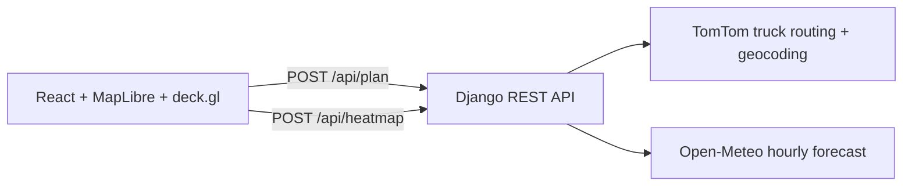

# Weather-Aware Truck Routing

A React + Django app that helps a truck driver choose the safest of three routes based on
weather, load weight and travel time. It checks the forecast at regular checkpoints for the time
the truck will actually be there, scores the risk with the assessment's rules (including the
load-weight rules), recommends a route and says why. A corridor heatmap with a 0–48 hour slider
shows how the weather moves around the trip.

- **Live app:** https://weather-truck-routing-phi.vercel.app
- **Walkthrough (Loom):** https://www.loom.com/share/25be9ac281e44c9aa983d939648ef231
- **Full documentation (Word):** [docs/Weather-Aware-Truck-Routing.docx](docs/Weather-Aware-Truck-Routing.docx)

## Assessment requirements

| Requirement | How it's met |
| --- | --- |
| Origin, destination, departure date/time and load weight | Trip form with place autocomplete, a departure picker in the driver's time zone (up to 7 days ahead, the forecast range) and load in lb |
| 3 route options from a routing API | TomTom truck routing with the load in kg, live traffic and 2 alternatives. If TomTom returns fewer, extra routes are forced through side points and near-duplicates are dropped; if there are still fewer than 3, the app says so |
| Weather every 10 / 25 / 50 miles at the truck's ETA | Checkpoints at mile 0, every 10, 25 or 50 miles (the driver picks) and the destination. Each ETA comes from TomTom's travel time along the route, and the forecast is read for that time |
| Risk from the provided rules | The spec's thresholds and load rules, unchanged (see [Risk rules](#risk-rules)) |
| Recommend the best route, balancing risk and time | Fewest Severe miles, then High miles, then average risk, then travel time, with a written reason (see [Ranking](#ranking)) |
| Routes, checkpoints, risk, ETAs and summaries on a map | Routes colored by risk, checkpoint popups (mile, highway, ETA, wind, gusts, rain, snow, level, reason) and ranked route cards beside the map with each route's highways and states |
| Weather heatmap along the corridor with a 0–48 h slider | 49 hourly frames for a 40 km corridor around all three routes, loaded once, with play, scrub and four metrics |

## Features

- Origin and destination with autocomplete, departure time in your own time zone, load weight
  (0–80,000 lb) and a checkpoint interval of 10, 25 or 50 miles.
- Routes drawn in segments colored by risk; the focused route is drawn on top and the others are
  dimmed. Click a card, a route line or its label to focus it; click a checkpoint for details.
- Route cards ranked safest first, each with distance, drive time, arrival time, miles per risk
  level, and a strip map showing where along the drive each risk sits. The recommended route
  explains why it won.
- Each route card names its main highways and the states it crosses ("Via I-88 → I-80 → I-76;
  Illinois, Iowa, Nebraska, Colorado"), and each checkpoint names its highway. Both come from
  TomTom's own guidance (road numbers and state codes) in the same routing response, with no
  extra API calls.
- A corridor heatmap (overall, wind, rain or snow) with a 0–48 hour slider and play button. Each
  route's truck is drawn where it would be at the selected hour.
- A map guide, opened from **Guide** in the legend, with the thresholds for every
  level, the load rules, what each map layer shows and how the route is picked.
- Labeled demo weather (a simulated winter storm) for showing the rules when the real forecast is
  calm. It is off by default, and every demo result carries a banner and a map label.
- Clear loading, error and warning states, including a warning when every route crosses No
  Travel weather. Works at phone width and from the keyboard, with labels for screen readers.
- One orchestrated animation: routes draw themselves out from the start and the heatmap fades in.
  All motion is skipped when the system asks for reduced motion.

## How it works



1. The browser sends the trip. Django asks TomTom for truck routes, using the load converted to
   kilograms and the departure time. TomTom's guidance steps also give each route's highways and
   states.
2. Checkpoints are placed along each route. Each one's ETA comes from TomTom's guidance
   instructions, which give the travel time to each point along the route, so it reflects the
   route's real speeds.
3. Forecasts for every checkpoint on every route are fetched from Open-Meteo in parallel batches
   of 50, with nearby checkpoints sharing one lookup.
4. Each checkpoint is classified, routes are scored and ranked, and the response goes back with
   simplified geometry ready to draw.
5. Once the routes are on screen, the browser asks for the heatmap. The server sends all 49
   hourly frames in one compact response, so moving the slider never touches the network.

The API is stateless (it runs as a Vercel serverless function), so the browser sends the route
lines back for the heatmap rather than the server remembering them.

### Code layout

```
api/index.py              Vercel entry point (Django WSGI app)
backend/routing/domain/   Pure, unit-tested logic: risk, checkpoints, recommender, geometry,
                          forecast parsing, heatmap frames, route details, demo weather
backend/routing/adapters/ TomTom and Open-Meteo clients (timeouts, retries, key never logged)
backend/routing/services/ Plan and heatmap orchestration
backend/routing/api/      Views, request validation, response shapes, JSON errors
frontend/src/             React app: form, cards, map layers, heatmap slider, map guide
docs/                     Full project documentation (Word)
scripts/smoke_test.py     End-to-end check of a deployed copy against the real APIs
```

## Risk rules

| Condition | Low | Moderate | High | Severe | No Travel |
| --- | --- | --- | --- | --- | --- |
| Wind (mph) | < 25 | 25 – < 35 | 35 – < 45 | 45 – < 55 | ≥ 55 |
| Rain (in/hr) | < 0.10 | 0.10 – < 0.25 | 0.25 – < 0.50 | 0.50 – 1.00 | > 1.00 |
| Snow (in/hr) | < 0.5 | 0.5 – < 1.0 | 1.0 – < 2.0 | 2.0 – 3.0 | > 3.0 |

Load rules apply to wind before combining:

- ≥ 55 mph → No Travel for any load
- 45 – < 55 mph and more than 30,000 lb → No Travel
- 35 – < 45 mph and more than 40,000 lb → Severe

A checkpoint's level is the worst of wind, rain and snow, and its reason names whatever set that
level (for example "Wind 38.0 mph with 42,000 lb load").

### Ranking

Each checkpoint covers the road halfway to its neighbors, so the covered miles add up to the
route length. Routes are compared in this order:

1. Fewest No Travel miles
2. Fewest Severe miles
3. Fewest High miles
4. Lowest distance-weighted average risk (Low 0, Moderate 1, High 2, Severe 3, No Travel 4)
5. Shortest travel time

Miles are rounded to 0.1 and average risk to 0.01 before comparing. The explanation compares the
winner with the runner-up, and when the fastest route lost, it also says what made the fastest
route riskier: "Route B: 100 Severe miles vs 150 on Route C; 2 h 51 min faster. Route A is
2 h 22 min faster but has 50 No Travel miles."

## Interpretation decisions

The assessment leaves some points open. These are the choices made and why.

| Topic | Decision | Why |
| --- | --- | --- |
| "Every 10 / 25 / 50 miles" | The driver picks the interval; the default is 25 mi | Reads as a choice of resolution, and a toggle shows all three |
| Threshold edges | Half-open bands (lower bound inclusive); No Travel uses the spec's ≥ / > exactly | The table repeats edge values (0.25 sits in two columns) |
| Values on an edge | Wind is classified at 0.1 mph and rain and snow at 0.01 in/hr, the precision shown | The label never contradicts the number on screen (34.96 shows as 35.0 mph and is High) |
| Combining conditions | Worst of wind, rain and snow, after load rules | A stretch of road is as dangerous as its worst hazard |
| Exactly 30,000 / 40,000 lb | Not escalated | The rules say "more than" |
| Wind | Sustained 10 m wind; gusts shown for information only | The thresholds match sustained-wind conventions |
| Rain | Open-Meteo `rain` + `showers`, but not total precipitation | `rain` alone misses convective showers; total precipitation would count snow twice |
| Weather at the ETA | Interpolated between forecast hours. Rain, snow and gusts are totals for the preceding hour, so each is treated as centered half an hour earlier | Avoids jumps at the top of each hour and lines hourly totals up with the time they describe |
| ETA | Departure plus the travel time to that mile, from TomTom's guidance instructions | Follows real road speeds rather than an average speed |
| No Travel in the ranking | Ranked before Severe | Not in the spec's list, but clearly the worst outcome |
| Ties and float noise | Compare rounded miles (0.1) and average risk (0.01); exact ties keep TomTom's order | Stops tiny numeric differences picking the winner |
| No Travel warning | Shown if any checkpoint on the best route is No Travel, even one too short to survive rounding | Safety first |
| Fewer than 3 routes | Detours forced through side points, near-duplicates dropped, and a note when there are still fewer than 3 | Meets "3 routes" where the road network allows, and is honest otherwise |
| Departure time | Up to 10 minutes in the past is accepted; more than 7 days ahead is rejected | Clocks drift a little; forecasts beyond a week aren't useful |
| Heatmap corridor | 40 km either side of every route. Cells start at 0.2° and only grow (up to 1°) to stay under 600 cells | Close to the forecast models' own resolution, but bounded for long trips |
| Heatmap frames | Frame 0 is the exact departure time, then every hour to +48 h; all four metrics are sent at once | Trucks and route ETAs line up with the slider, and switching metric needs no request |
| Demo weather | Placed across the middle of the planned trip (sized to the trip length), not at a fixed place | Works for any trip; a storm at one fixed place would only affect trips through that region |

## API

| Endpoint | What it does |
| --- | --- |
| `GET /api/health` | `{"status": "ok", "tomtom_key": true}`; reports whether the key is set, never the key itself |
| `GET /api/geocode?q=denv` | Up to five US/Canada matches: `[{"label", "lat", "lon"}]` |
| `POST /api/plan` | Body: `origin`, `destination` (`{lat, lon, label}`), `departure` (ISO time), `load_lb`, `interval_mi` (10/25/50), `scenario` (`null` or `"winter_storm"`). Returns `routes` (geometry, risk segments, checkpoints, summary, rank), `recommended_id`, `explanation`, `warnings` and `scenario` |
| `POST /api/heatmap` | Body: `routes` (the plan's geometries), `departure`, `load_lb`, `scenario`. Returns cell centers, `cell_deg`, `hours` (49), `start`, and base64 `frames` per metric (one byte per cell per hour, laid out hour by hour) |

Errors always look like `{"error": {"code": "NO_ROUTE", "message": "Couldn't find a truck route
between those places. Try points closer to a road."}}`, including 404s and server errors.

## Tech stack and services

- **Backend:** Django 5.2 and Django REST Framework, httpx, shapely and numpy. Python 3.12.
- **Frontend:** React 19, TypeScript, Vite, MapLibre GL (via react-map-gl) and deck.gl.
- **TomTom** (key required, free tier): truck routing with `travelMode=truck`, the vehicle weight
  in kg and alternatives; plus geocoding.
- **Open-Meteo** (no key, free for non-commercial use): hourly wind, gusts, rain, showers and
  snowfall, requested in mph and inches.
- **OpenFreeMap** (no key): map tiles.
- **Vercel** (Hobby): the static frontend and the Django API from one URL, so no CORS is needed.

## Run it locally

You need Python 3.12+, Node 22+ and a free TomTom API key (my.tomtom.com/keys).

```bash
cp .env.example .env          # Windows: copy .env.example .env
```

Set `TOMTOM_API_KEY` in `.env` (and leave `DEBUG=True` for local work). Then:

```bash
# terminal 1: API on http://localhost:8000
python -m venv .venv
source .venv/bin/activate     # Windows: .venv\Scripts\activate
pip install -r requirements-dev.txt
cd backend
python manage.py runserver

# terminal 2: app on http://localhost:5173 (Vite forwards /api to Django)
cd frontend
npm install
npm run dev
```

| Variable | Purpose |
| --- | --- |
| `TOMTOM_API_KEY` | TomTom routing and search. Server-side only; never sent to the browser or logged. |
| `SECRET_KEY` | Django secret. Required when `DEBUG` is off. |
| `DEBUG` | `True` locally, `False` in production. |

## Tests

```bash
ruff check . && ruff format --check .
cd backend && pytest            # 318 tests, offline
cd frontend && npm run lint && npm run format:check && npm test && npm run build   # 61 tests
```

- **Risk:** every threshold edge from the spec (24.9/25.0 mph, 0.49/0.50 in/hr, and so on), every
  load-rule edge (40,000 vs 40,001 lb, 30,000 vs 30,001 lb), and checks that risk never drops as
  wind, rain, snow or load increase.
- **Checkpoints:** positions, the destination checkpoint, coverage adding up to route length,
  and ETA interpolation.
- **Ranking:** each key breaking ties in order, rounding, the explanation text, and a worked
  example where a heavier load changes the winner.
- **Route details:** highway and state names are checked against a recorded real TomTom
  response for three Chicago–Denver routes (`backend/routing/tests/data/`), including road
  numbers with directions ("I-80 W") and concurrent highways.
- **Adapters and API:** run against fake TomTom and Open-Meteo servers shaped like their
  documented responses, so the tests are fast and need no network. They cover retries, rate-limit
  backoff, timeouts, no route, a missing key, unit conversion, the key never appearing in
  responses or logs, and every validation error.
- **Heatmap and demo weather:** corridor width, the cell cap, frame layout, load sensitivity, and
  the demo flip: the same trip recommends a different route at 25,000 and 45,000 lb.
- **Frontend:** the API client, formatting, route and heatmap helpers, the route card and its
  highway line, the checkpoint popup, the heatmap's retry, the intro animation, and the map
  guide. A test reads the backend's `risk.py` and fails if the guide's thresholds ever differ
  from the real rules.

CI runs all of the above on every push (`.github/workflows/ci.yml`).

## Deployment

The app is deployed on Vercel as one project. `vercel.json` builds the React app as static files
and runs Django as a Python serverless function under `/api`. Every push to `main` redeploys.

- **Configuration:** `TOMTOM_API_KEY`, `SECRET_KEY` and `DEBUG=False` are set as Vercel
  environment variables. Nothing secret is in the repository.
- **Framework detection:** `vercel.json` pins `"framework": "vite"`. Without it, Vercel can detect
  Django from `backend/manage.py` and send every request to Django, which would hide the frontend.
- **Checking a deployment:** the smoke test calls the live app with the real TomTom and
  Open-Meteo APIs and checks the page, health, geocoding, a live plan, the heatmap and the demo
  load flip:

```bash
python scripts/smoke_test.py https://weather-truck-routing-phi.vercel.app
```

## Known limitations and next steps

- **Vehicle weight:** TomTom receives the load weight as `vehicleWeight`. It expects the whole
  vehicle's weight, so adding an empty-truck weight would make bridge and weight restrictions
  more realistic.
- **Open-Meteo's free plan** limits calls per minute and per day, by IP address, and Vercel's
  servers share IP addresses with other apps. The server waits and retries when it is rate
  limited (honoring `Retry-After`), and the heatmap retries once on its own. A paid Open-Meteo
  plan or a forecast cache would remove the limit.
- **Heatmap resolution:** cells are 0.2–1° wide. The routes use the forecast at each checkpoint's
  exact point, so a small, intense feature can look slightly different on the map than on the
  route.
- **States on a route** come from the state TomTom gives each guidance step. They are correct
  for the order a route crosses states, but not for the state at every mile (a long stretch with
  no steps keeps the last state), so checkpoints name their highway only.
- **Trucks on the map** follow the route line, but their speed between two checkpoints is taken
  as constant. That's exact at checkpoint times and close in between.
- **Next steps:** suggest the earliest clear departure when every route crosses No Travel,
  record more real API responses as test fixtures, and add hazardous-load routing options.
